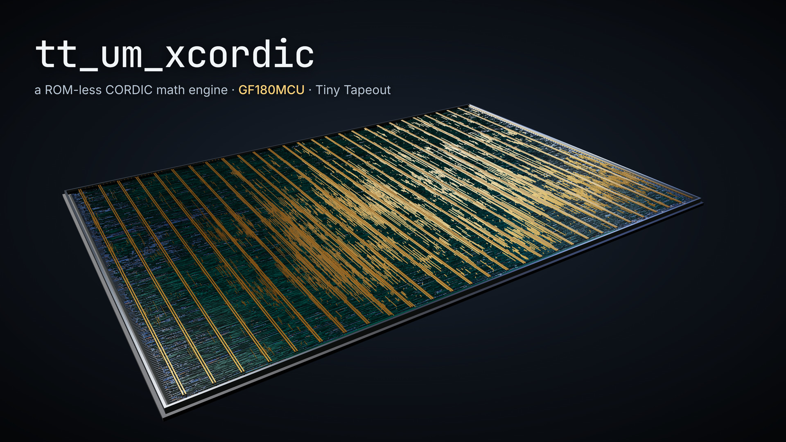

   

# Xcordic: ROM-Less CORDIC function unit



This is a small math chip. You send it a number or two over SPI and it sends back a sine, a logarithm, a square root, or one of eight other functions, all in 16-bit fixed point. It is built for Tiny Tapeout GF26c (GF180MCU, 3×4 tiles, 25 MHz).

It computes with CORDIC, but without the lookup table of angles that a CORDIC normally carries. The angles are worked out on the fly.

We have done this once before. The first version went out on ttsky25a, came back from the fab with two wrong constants in it, and had to be corrected from the host side. This chip is the one we wish we had sent the first time, and most of what follows is about the decisions that came out of that experience.

So this page is not a CORDIC tutorial. If you want to know how CORDIC works, or how to talk to the chip, start here instead:

- **Using the chip** (pins, SPI, the instruction list, timing, worked examples): [`docs/info.md`](docs/info.md)
- **The proofs, one by one:** [`formal/README.md`](formal/README.md) and [`docs/FORMAL.md`](docs/FORMAL.md)
- **Running it on an FPGA:** [`fpga/ulx3s`](fpga/ulx3s) and [`fpga/ku5p`](fpga/ku5p) both tested on board.

## What's in the repository

| Path | What |
|---|---|
| `src/` | the RTL |
| `test/` | cocotb and Verilog testbenches, RTL and gate level |
| `formal/` | proofs, the specification, exhaustive simulation, mutation testing, results |
| `docs/` | `info.md` (the datasheet), `FORMAL.md`, `GF26C_IO.md` |
| `fpga/` | the ULX3S and KU5P projects |
| `third_party/ttsky_orig/` | the ttsky25a RTL, untouched, for the baseline proofs |

What this doc covers:

1. [How we make the angles](#1-how-we-make-the-angles)
2. [How one instruction becomes a few CORDIC passes](#2-how-one-instruction-becomes-a-few-cordic-passes)
3. [What the numbers promise](#3-what-the-numbers-promise)
4. [How we know it works, and how wrong it can be](#4-how-we-know-it-works-and-how-wrong-it-can-be)

A note on units. The chip you get is built with `GUARD = 4`: results have 12 fraction bits, but inside, everything is carried with 16. So there are two sizes of "one step" in this page. An **output LSB** is 2⁻¹², the step you see. An **internal LSB** is 2⁻¹⁶, sixteen times smaller.

## 1. How we make the angles

Every CORDIC step needs to know the angle atan 2⁻ˢ for its shift s. Normally that is a small table. We compute it (`src/xcordic_atan.v`), and the way we do it is the reason the project exists.

### The series we use

| Mode | Angle for shift s, from s = 2 up |
|---|---|
| circular | 2⁻ˢ − 2⁻³ˢ/3 + 2⁻⁵ˢ/5 |
| hyperbolic | 2⁻ˢ + 2⁻³ˢ/3 + 2⁻⁵ˢ/5 |
| linear | 2⁻ˢ |

That is the Taylor series of atan and atanh, cut after three terms. It sounds crude, but the corrections die off very fast. By s = 7 the cube term is under a hundredth of an internal LSB and the angle is simply 2⁻ˢ. Only five angles per mode, s = 2 to 6, get any real correction at all.

### Where we don't trust the series

The series is poor for big angles, and that is exactly what bit us on the first chip. So the first angles don't come from the series. They sit in registers:

| Angle | Register | Reset value | Why not the series |
|---|---|---|---|
| circular, s = 0 | `atan0` | π/4 | at x = 1 three terms are nowhere near |
| circular, s = 1 | `atan1` | atan ½ | three terms land 61 internal LSBs too high (3.8 output LSBs) |
| hyperbolic, s = 1 | `atanh1` | atanh ½ | three terms land 91 internal LSBs too low |

Two more registers, `kc` and `kh`, hold 1/K = 0.60725 and 1/K′ = 1.20750. A pass that starts from one of these comes out with the CORDIC gain already cancelled.

All five can be rewritten with the `cfg` instruction. That is the lesson from ttsky25a in one sentence: last time a wrong constant was frozen into silicon, and this time a wrong constant is one register write away from being fixed. The reset values are the correct ones, so you only touch them if you want to.

### Dividing by 3 and 5 without dividing

This is the part we like best. The input to the series is x = 2⁻ˢ, a single 1 bit. Its cube, 2⁻³ˢ, is also a single bit, and so is its fifth power. And a single bit divided by 3 is always the same bit pattern, just sitting at a different place.

So "x³/3" needs no multiplier, no divider, not even an adder. It is a constant, shifted right:

```
1/3 ≈ 0.0101010101b = 1/4 + 1/16 + 1/64 + 1/256 + 1/1024 = 0.333008   (0.10 % low)
1/5 ≈ 0.00110011b   = 1/8 + 1/16 + 1/128 + 1/256         = 0.199219   (0.39 % low)

x³/3 = pat3 >> 3s          x⁵/5 = pat5 >> 5s
```

A few details that took some care:

- We cut the patterns short on purpose. x⁵ is never larger than 2⁻¹⁰, so any finer bits of 1/5 would fall off the end anyway.
- The three terms are added with 4 spare fraction bits, half an internal LSB is added for rounding, and the spare bits are dropped.
- The shifts 3s and 5s are worked out three iterations early and held in registers, and the two series terms one iteration early. The angle then reaches the adder straight from a register. Before we did this, the angle path was the second slowest thing on the chip.

### What this costs in accuracy

Here is the generated angle minus the true one, in internal LSBs:

| s | circular | hyperbolic |
|---|---|---|
| 2 | +1.08 | −0.73 |
| 3 | +0.27 | −0.07 |
| 4 | +0.32 | −0.35 |
| 5 | −0.33 | +0.33 |
| 6 | +0.08 | −0.08 |
| 7 and up | 0 | 0 |

The worst one is 1.08 internal LSBs. That is 0.07 of the step you actually see at the output. A perfect table would be within 0.5 internal LSBs, so we give up about half an internal LSB on one angle, and nothing you could measure in a result. Most of that s = 2 error is the x⁷/7 term we left out (0.57 LSB); the rest is our shortened 1/3 and 1/5.

For the curious: with `GUARD = 0` the generator keeps only the cube term, with a shorter 1/3, and truncates. That reproduces the ttsky25a angle table bit for bit, which is how we check the new design against the old silicon.

### How many steps, and which shifts

| Mode | Steps | Shifts | How far it reaches |
|---|---|---|---|
| circular | 15 | 0, 1, …, 14 | ±1.743 rad |
| linear | 17 | 0, 1, …, 16 (down to one internal LSB) | \|z\| < 2 |
| hyperbolic | 17 | 1, 2, 3, 4, 4, 5, …, 13, 13, 14, 15 | ±1.118 |

Hyperbolic CORDIC has to repeat a couple of shifts or it leaves gaps; we repeat 4 and 13. Even that sequence is not a table. It is a little arithmetic on the step counter.

## 2. How one instruction becomes a few CORDIC passes

The engine (`src/xcordic_engine.v`) only knows how to do one thing: run a pass. You give it a mode, a rule for which way to turn, and three starting values. Everything that makes "sin" or "ln" out of that lives in the sequencer (`src/xcordic_core.v`), which strings together one to three passes per instruction.

### The state machine

```
IDLE ─► PREP ► PRE1 ► PRE2 ► PRE ─► RUN ─► MIDP ► MID1 ► MIDS ► MID ─► DONE
  │                                  ▲                            │
  ├─► CFG ─► DONE                    └──────── next pass ─────────┘
  └─► XRUN (mul, div, sqrt on the exact unit) ─► DONE
```

`PRE` launches the first pass. `MID` picks up a finished pass and either launches the next one or writes the answer.

The states around them (`PREP`, `PRE1`, `PRE2` and `MIDP`, `MID1`, `MIDS`) do no arithmetic you would recognise. They are there because GF180 is slow at its worst corner. Setting up a pass means finding magnitudes, counting leading zeros, wrapping an angle, and we could not fit all of that in one 40 ns clock. So those states capture the work in halves, and `PRE` and `MID` are left with only a shift, a negate and an add. It costs a few clocks per pass and changes no result.

The engine got the same treatment. It computes both x + d and x − d and picks one afterwards, so deciding the sign no longer sits in front of the carry chain.

### What each function actually runs

| Function | First, bring the input into range | Then run | Clocks |
|---|---|---|---|
| sin, cos | fold the angle into one quadrant | one circular rotation starting at (1/K, 0) | 27 |
| tan | same as sin | the rotation, then sin / cos with a full-range divide | up to 50 |
| atan2 | scale both inputs by the same power of two; flip into the right half-plane | one circular vectoring pass | 27 |
| hypot | the same scaling | vectoring (which gives K·r), then a linear pass to multiply by 1/K | 50 |
| exp | write t = k·ln 2 + r | one hyperbolic rotation by r from (1/K′, 0); answer is (cosh + sinh)·2ᵏ | 29 |
| ln | write a = m·2ᵉ, m between 1 and 2 | one hyperbolic vectoring of (m + 1, m − 1); answer is 2z + e·ln 2 | up to 29 |
| tanh | get E = e^(−2\|a\|) the way exp does | the hyperbolic rotation, then (1 − E) / (1 + E) with the full-range divide | 56 |
| rotc | the same scaling and the quadrant fold | a rotation, then two linear passes ×1/K, one per output | 77 |
| mul, div, sqrt | nothing | no CORDIC at all: the exact unit | 24, up to 25, up to 23 |

Clocks are counted at the core, from the start of the instruction to its result.

### The tricks, one at a time

**One wrap is enough for any angle.** We wrap the angle by 2π once (add 2π if it is negative, subtract if it is 2π or more), pick the quadrant, subtract that many quarter turns, and afterwards swap and negate the two outputs to undo it. Why does a single wrap cover everything? Luck with the number format. Inputs run from −8 to 8 radians, and 8 − 2π is 1.717, which is just inside the 1.743 the rotation can reach. An angle below −2π is still negative after the wrap, and we simply rotate by a negative angle.

**Scale both inputs together.** atan2, hypot and rotc shift both operands left by the same amount, until the bigger one is between 1 and 2. The angle doesn't change, and a tiny input keeps its meaningful bits all the way through the pass. hypot and rotc shift the answer back at the end.

**Flip the left half-plane.** Vectoring only converges when x is positive. If it isn't, we negate the vector and start z at +π or −π depending on the sign of y.

**exp without a divider.** We need k = round(t / ln 2). Instead of dividing, we multiply by 1.4375, which is 1 + ½ − 1⁄16: two shifts and two adds. That is not exactly 1/ln 2, so now and then k comes out one off. It doesn't matter. Whatever k we picked, the remainder r = t − k·ln 2 is computed properly from it (with ln 2 held to 20 fraction bits), and r stays under about 0.4 when the pass can handle 1.118. The 2ᵏ at the end is just a shift.

**ln from a single pass.** With m between 1 and 2, we start the vectoring pass at x = m + 1 and y = m − 1. It returns atanh((m − 1)/(m + 1)), which is exactly half of ln m. The ratio never exceeds ⅓, so convergence is never in question.

**tanh is built from parts we already had.** exp's reduction gives E = e^(−2|a|), and the divide gives (1 − E)/(1 + E). The only new thing is that −2|a| can reach −16, which doesn't fit our number format, so that one intermediate is wider. We put the sign back by negating the final 16-bit result, which makes tanh perfectly odd.

**The full-range divide** (used by tan and tanh). Normalise top and bottom separately to between 1 and 2, run one linear pass to get a quotient between ½ and 2, then shift by the difference of the two normalisations, round and saturate. If the bottom is zero, the result saturates in the direction of the top and the SAT flag is set.

**Getting rid of the gain.** sin, cos and exp can start from 1/K or 1/K′, so their results come out clean. hypot and rotc can't, because their starting point is your data, so they spend an extra linear pass multiplying by 1/K.

## 3. What the numbers promise

### The format

Operands and results are **S3.12**: 16-bit two's complement with 12 fraction bits, from −8 up to just under 8, in steps of 1/4096.

Inside, values are S3.F with F = 12 + GUARD. Operands are shifted up by GUARD on the way in, and every register, angle and constant carries those extra bits. `GUARD = 4` is what is taped out. `GUARD = 0` is the old ttsky25a datapath, kept so the two can be compared bit for bit. The step counts follow GUARD as well: 13 + (GUARD + 1)/2 circular steps, F + 1 linear ones.

### Rounding

We round once, at the very end, and always the same way: add half an output LSB and drop the low bits. Ties go up, toward +∞, for every function.

Inside a pass the shifts truncate, the way the original engine did. We made two exceptions, and in both cases we tried it both ways and kept the one that measured better:

- The linear pass that forms a product for you (`mac`) rounds its x >> s term, and freezes as soon as z hits exactly 0. Truncating there adds up over a long run of steps in the same direction: up to 4 LSBs on a product. With rounding it is 1.4.
- The 1/K passes in hypot and rotc keep truncating. It turns out their truncation cancels part of the vectoring pass's bias. When we "fixed" it, hypot's average error went up, from 0.37 to 0.51 LSB. So we put it back.

The few intermediate scalings (ln's mantissa, tanh's E, k·ln 2) round as well.

### Saturation and flags

Every result comes back with two flags.

| Flag | It means |
|---|---|
| SAT | the result (or one half of a pair) didn't fit and was clipped to 0x7FFF or 0x8000 |
| INV | you asked for something that has no answer |

| Case | You get | Flag |
|---|---|---|
| a true result outside −8…8, any function | 0x7FFF or 0x8000 | SAT |
| ln a with a ≤ 0 | 0x8000 | INV |
| sqrt a with a < 0 | 0x8000 | INV |
| a / 0, a not zero | 0x7FFF or 0x8000, by the sign of a | INV |
| 0 / 0 | 0 | INV |
| tan right on a pole (cos rounds to 0) | 0x7FFF or 0x8000 | SAT |

One caveat, stated plainly. The flags are a promise about the functions (ops 8–19). The seven base passes (rot, sincos, vec, mac, ldiv, hsincos, hvec) are raw access to the engine: their SAT flag only reports clipping at the final 16-bit step, and a value that overflows in the middle of a pass wraps silently. `docs/info.md` lists the input limits that keep them safe.

### mul, div and sqrt are exact

These three don't use CORDIC. They run on a separate little unit (`src/xc_exact.v`) with one 20-bit adder, working one bit per clock: shift-and-add multiply (16 steps), restoring divide (17 steps), digit-by-digit square root (15 steps).

```
mul:  floor(a·b / 4096 + ½)
div:  floor(4096·a / b + ½)
sqrt: floor(√(4096·a) + ½)        then saturated to −8…8
```

What that gives you:

- The answer is the exact value, rounded half up. The error is **never more than half an LSB**, for any operand, at any GUARD.
- The unit works on magnitudes and fixes the sign at the end. To round a negative number half up from its magnitude you need to know whether anything non-zero was thrown away, so it keeps a sticky bit for that.
- A divide that obviously can't fit (|a| at least 16 times |b|) saturates early without grinding through the steps.
- The result depends only on the two operands, never on whatever ran before. That one is proved (section 4).

We did have CORDIC versions of all three, and we took them out. A CORDIC multiply, divide or square root can be made good, but it can't be made to promise half an LSB.

## 4. How we know it works, and how wrong it can be

Our approach has two halves. First prove that the RTL does exactly what a written specification says. Then measure how accurate that specification is, on every input there is.

### What is proved

There are 185 SymbiYosys proof tasks. 155 pass. The other 30 fail on purpose: 29 are SPI timings outside the datasheet, where the failure is the solver showing us precisely where the limit is, and one is the lock-up bug in the original design.

| Block | Proof | What it says |
|---|---|---|
| SPI slave | N1, N1c, G1 | every bit of every byte gets through, in both SPI modes, for any master inside the datasheet timing; and again at the chip's pads with the I/O delays included |
| Frame logic | N2 | each frame turns into exactly the right instruction and sends back exactly the right bytes; the chip recovers from a confused host; a frame is never acted on by the wrong protocol |
| Sequencer | F3 | for every instruction, every operand and every config value: exactly the passes the specification calls for, and exactly its result and flags |
| Engine | F2 | every step is the specified micro-rotation, look-ahead registers included |
| Adder, angle generator | F7 | the fast adder equals a + b + ci; the two-stage angle generator equals the reference one |
| Self-test | F5 | it is invisible unless you run it, and when you do, it runs exactly the documented sequence |
| Exact unit | F6 | its handshake, and that its result depends on the operands alone |

The specification (`formal/spec/xcordic_spec.vh`) was written from the spec document, in a different style from the RTL, so the two are unlikely to share a mistake.

We also tested the tests. We planted 52 bugs in the design on purpose, one at a time, and checked that a proof caught each one. All 52 were caught.

### What is checked on every input

| What | Inputs | Result |
|---|---|---|
| mul and div, against plain integer arithmetic | all 2³² operand pairs, each | 0 mismatches |
| sqrt, against plain integer arithmetic | all 2¹⁶ | 0 mismatches |
| sin, cos, tan, exp, ln, sqrt, tanh, through the whole core | all 2¹⁶, each | bit-exact with the golden model |
| atan2, hypot, mul, div, through the whole core | all 2³² pairs, each | bit-exact with the golden model |

One thing to be upfront about: the big two-operand run simulated the adder as a plain a + b + ci, because that runs five times faster. F7 proves the real adder is equal to it, and a 1.3 % sample with the real adder also matched exactly. The golden model (`formal/exhaustive/xc_model.hpp`) is the same one the bench harness uses.

Beyond that, the whole chip passes its RTL and gate-level simulations, and all four ULX3S FPGA builds (GUARD 4 and 0, at 25 and 40 MHz) match the model exactly on real hardware.

### How wrong it can be

Worst and average error over every possible input, in output LSBs, measured on the RTL:

| Function | Worst | Average | Note |
|---|---|---|---|
| mul, div, sqrt | 0.50 | 0.25 | exact, then rounded |
| tanh | 0.80 | 0.19 | |
| atan2 | 1.07 | 0.28 | |
| cos | 1.16 | 0.27 | |
| sin | 1.18 | 0.27 | |
| ln | 1.18 | 0.30 | |
| hypot | 0.81 relative | 0.37 | 2.46 absolute when the result is near 8 |
| exp | 1.10 relative | 0.34 | 4.89 absolute when the result is near 8 |
| tan | 5.63 relative | 1.10 | only right beside the poles |

"Relative" means the error divided by the size of the result (or by 1, if the result is smaller than 1). exp, hypot and tan stretch their input, so the half-LSB of uncertainty that every input already carries gets stretched too. No design can fix that part.

Where does a worst case of about 1.2 LSB come from? This is our own back-of-the-envelope accounting, not something we proved:

| Source | Size, in output LSBs |
|---|---|
| the final rounding to S3.12 | up to 0.50 |
| the angle still left over after the last step (2⁻¹⁴ rad) | up to 0.25 |
| truncated shifts inside the pass: 15–17 steps, up to one internal LSB each | up to about 1, usually a small fraction of that |
| generated angles versus true ones (section 1), added up over a pass | up to about 0.13 |
| the gain seed and other constants, rounded to F bits | under 0.05 |

The guard bits are what keep the truncation line small. Build the same design with `GUARD = 0` and the same functions measure 7 to 10 LSBs at worst (sin 8.8, ln 10.6, tanh 7.0), while mul, div and sqrt stay at 0.5.
