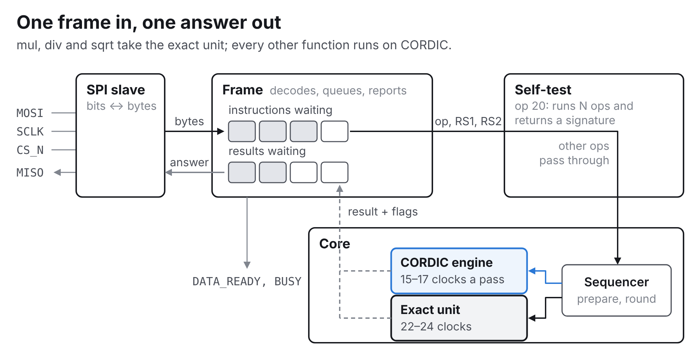
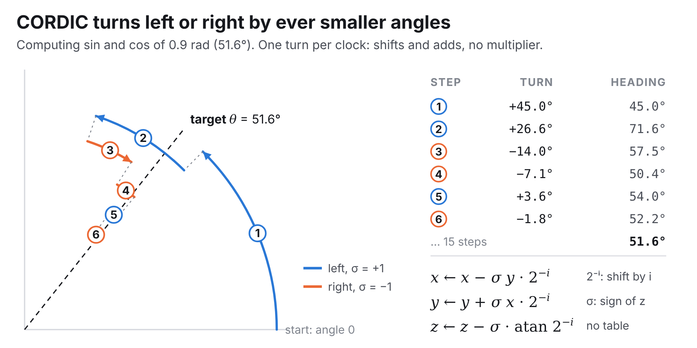
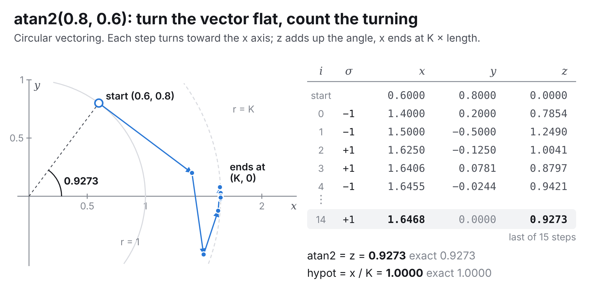
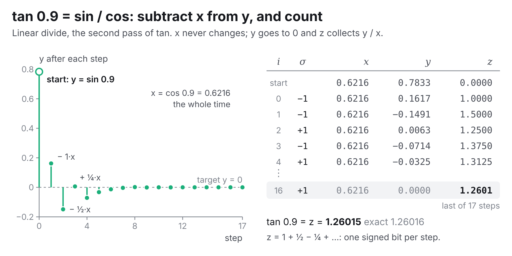
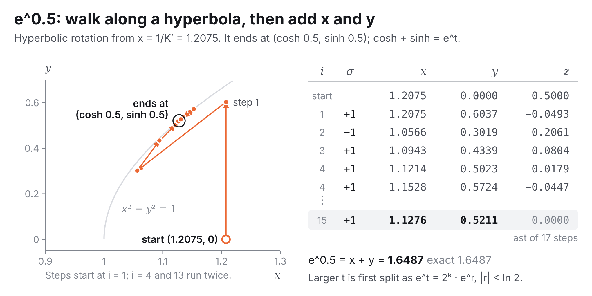
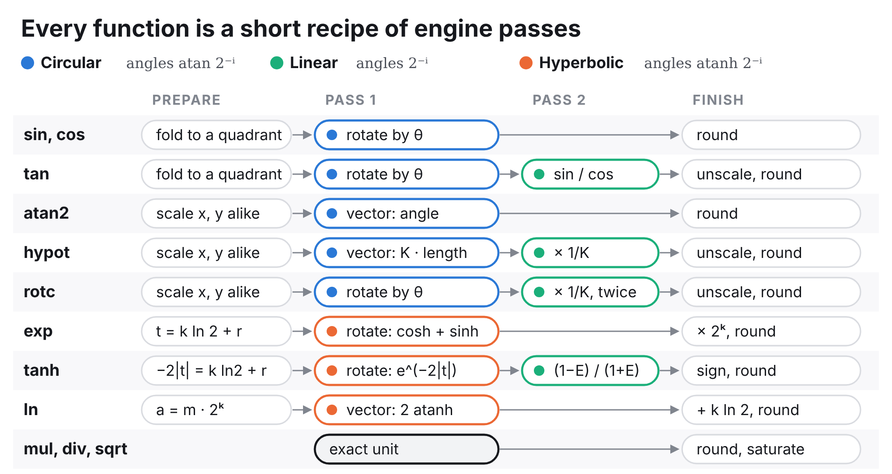
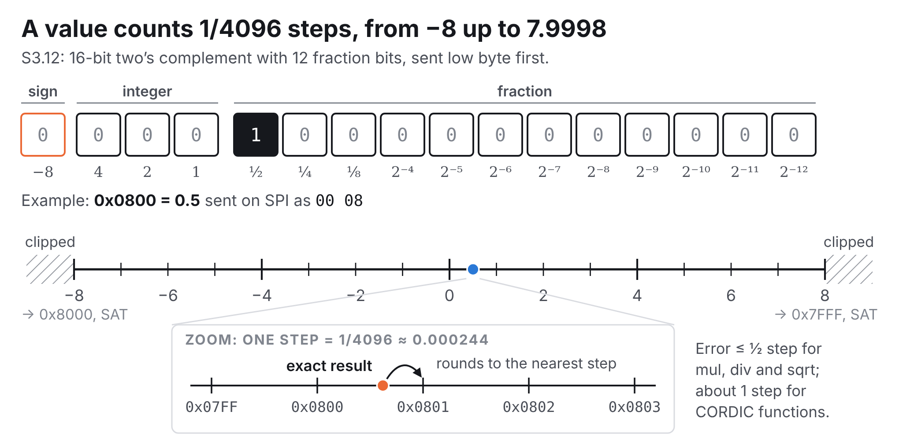
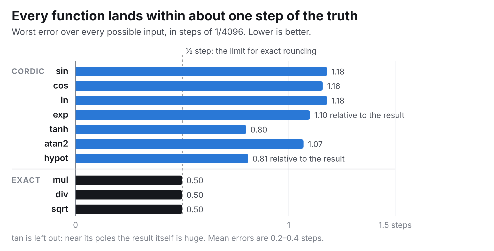

## How it works

Xcordic is a ROM-less CORDIC function unit, a small math co-processor you talk to over SPI. Send it an instruction such as "sin of 0.5" or "divide a by b", and it sends back the answer as a 16-bit fixed-point number. It is the corrected successor of `tt_um_romless_cordic_engine` (ttsky25a) and every block of it is formally verified.

**What it computes:**
- **Trigonometry:** sin, cos, tan, atan2, hypot, and vector rotation (with or without the CORDIC gain).
- **Exponentials:** exp, ln, tanh, sinh/cosh.
- **Arithmetic:** multiply, divide and square root, rounded exactly to the nearest step.
- **Raw CORDIC passes,** for anyone who wants to build their own functions.

**Extras:**
- A 4-deep instruction queue and a 4-deep result queue, so a host can stream work without waiting.
- Two flags with every result: SAT (the result was clipped) and INV (invalid argument).
- A built-in self-test instruction.

### The math

Most functions run on **CORDIC**, an old trick for computing trigonometry with nothing but shifts and adds. To turn a vector by an angle θ, it turns it by a fixed sequence of ever-smaller angles, each step to the left or to the right, until the remaining angle is used up. The step angles are atan(1), atan(½), atan(¼) and so on. Multiplying by 2⁻ⁱ is just a right shift, so each step costs two shifts and three additions.

The steps also stretch the vector by a constant K ≈ 1.6468. Starting from x = 1/K cancels it, so the vector lands exactly on (cos θ, sin θ). Xcordic has no table of step angles: it computes each one from a short series (2⁻ⁱ − 2⁻³ⁱ/3 + 2⁻⁵ⁱ/5), and the two largest come from registers.

The same step, with one sign changed, works on a line and on a hyperbola as well as on a circle. So one engine also does the divides inside tan and tanh, multiply-accumulate (linear), and exp, ln and tanh (hyperbolic).

#### One engine, three geometries

Every step is x ← x − m·σ·y·2⁻ⁱ, y ← y + σ·x·2⁻ⁱ, z ← z − σ·eᵢ. Only m and the step angle eᵢ change. In **rotation** mode σ is the sign of z, which drives z to 0. In **vectoring** mode σ is picked to turn y toward 0, and z adds up the turning.

| | Circular | Linear | Hyperbolic |
|---|---|---|---|
| m | 1 | 0 | −1 |
| step angle eᵢ | atan 2⁻ⁱ | 2⁻ⁱ | atanh 2⁻ⁱ |
| steps i (GUARD 4) | 0 … 14: 15 steps | 0 … 16: 17 steps | 1 … 15 with 4 and 13 twice: 17 steps |
| gain | K ≈ 1.6468 | none | K′ ≈ 0.8282 |
| rotation gives | K·(x cos z − y sin z), K·(y cos z + x sin z) | y + x·z | K′·(x cosh z + y sinh z), K′·(y cosh z + x sinh z) |
| vectoring gives | x = K·√(x² + y²), z + atan(y/x) | z + y/x | x = K′·√(x² − y²), z + atanh(y/x) |
| used for | sin, cos, tan, atan2, hypot, rot, rotc | tan and tanh (the divide), hypot and rotc (× 1/K), mac | exp, ln, tanh, hsincos, hvec |
| example below | atan2(0.8, 0.6) | tan 0.9 = sin / cos | e^0.5 |

The three examples below run the chip's step sequences on ideal numbers. The chip does the same steps in fixed point with 4 guard bits, and its rounded result lands within about one step (1/4096) of the true value.

**atan2(0.8, 0.6) by circular vectoring.** The point (0.6, 0.8) starts 53.1° above the x axis, with z = 0. Each step turns the vector toward the axis and adds the angle it turned to z:
- Step 0: y is above the axis, so the vector turns right by 45°. It lands at (1.4, 0.2) with z = 0.7854.
- Step 1: it turns right again by 26.6° and overshoots to y = −0.5.
- Step 2: it turns back left, and so on with ever smaller turns.

Every turn also stretches the vector slightly. So x grows from 0.6 to 1.6468, and the path moves out from the r = 1 circle to the r = K circle. After 15 steps y is 0. z holds the total angle, 0.9273 rad = atan2(0.8, 0.6), and x holds K × the length. hypot removes the gain with one linear pass (× 1/K) and gets 1.0000.

On the chip, atan2 and hypot first scale x and y by the same power of two, to use the whole register. A point with x < 0 is flipped through the origin first, and z starts at ±π.

**tan 0.9 by a linear divide.** tan takes two passes. A circular rotation gives sin 0.9 = 0.7833 and cos 0.9 = 0.6216, and then this linear pass divides them. In linear mode x never changes. Each step adds or subtracts x·2⁻ⁱ to bring y closer to 0, and adds the matching ±2⁻ⁱ to z:
- Step 0 subtracts 1·x: y = 0.1617, z = 1.
- Step 1 subtracts ½·x and overshoots: y = −0.1491, z = 1.5.
- Step 2 adds ¼·x back: z = 1.25.

So z builds up y/x one signed binary digit per step. After 17 steps z = 1.26015; the true value is 1.26016.

On the chip both operands are first scaled to the same range, and the result is scaled back at the end. tanh uses the same pass for its (1 − E) / (1 + E).

**e^0.5 by hyperbolic rotation.** exp starts at x = 1/K′ = 1.2075, y = 0, z = 0.5. It rotates by z along a hyperbola instead of a circle, using the angles atanh 2⁻ⁱ:
- The steps start at i = 1, because atanh 1 is infinite.
- Step 1 rotates by +0.5493 and overshoots: z = −0.0493.
- Step 2 turns back by 0.2554, and so on.
- Steps 4 and 13 run twice. Hyperbolic angles shrink a little faster than by half each step, and the repeats let the steps still reach every angle in range.

The 1/K′ start cancels the gain. After 17 steps x = cosh 0.5 = 1.1276 and y = sinh 0.5 = 0.5211, and e^0.5 = x + y = 1.6487.

One hyperbolic pass only reaches about ±1.1, so exp first writes t = k·ln 2 + r. It runs the pass on r and shifts the result left by k, because e^t = 2ᵏ · e^r. tanh uses the same pass to get E = e^(−2|t|), and ln uses the vectoring form, ln m = 2 atanh((m − 1)/(m + 1)).

#### From passes to functions

The sequencer first brings each input into range, for example by folding an angle into one quadrant or by writing eᵗ as 2ᵏ · eʳ. Then it chains one to three engine passes, and rounds the result once at the end.

mul, div and sqrt do not use CORDIC: a separate unit computes them exactly, one bit per clock, so their error is at most half a step.

### Numbers

All values are **S3.12**: 16-bit two's complement with 12 fraction bits, so they run from −8 to just under 8 in steps of 1/4096. On SPI they are sent little endian.

### Accuracy

Measured on the RTL over every possible input (all 65,536 for one-operand functions, all 2³² pairs for two-operand ones).

exp and hypot are measured relative to the result. Large results carry a larger absolute error (exp up to 4.9 steps, hypot up to 2.5), because the input has only 12 fraction bits.

Mean errors are 0.2–0.4 steps. tan is accurate except right next to its poles. Internally the CORDIC datapath keeps 4 extra fraction bits (`GUARD = 4`).

### Pins

| Pin | Function |
|---|---|
| ui[0] | SCLK |
| ui[1] | MOSI |
| ui[2] | CS_N |
| ui[3] | PROTO: 0 = legacy frames (ttsky25a), 1 = command frames |
| ui[4] | CPHA: 0 = SPI mode 0, 1 = SPI mode 1 |
| uo[0] | MISO |
| uo[1] | DATA_READY |
| uo[2] | BUSY |

SPI uses CPOL = 0, MSB first. CS can go high after every byte or stay low for a whole frame. Change PROTO only while CS is high and nothing is in progress.

### Command protocol (PROTO = 1)

Each instruction is one CS frame.

**Send:** `CMD`, then `RS1` (4 bytes), then `RS2` (4 bytes).
- `CMD = 0x80 | op` queues instruction `op` when CS rises.
- `CMD = 0x00` just reads.
- One-operand instructions can stop after `RS1` (5 bytes in all).

**Receive, in the same frame:** `STATUS`, `RD` (4 bytes), `FLAGS`, then zeros. All of them are captured when CS falls.

| Field | Meaning |
|---|---|
| `STATUS` bits 7–4 | `SEQ`: the number of the result shown (completions, mod 16) |
| `STATUS` bit 3 | `FULL`: 4 instructions are waiting; a new one would be rejected |
| `STATUS` bit 2 | `ERR`: the last instruction was rejected (queue full, unknown op, frame under 5 bytes) |
| `STATUS` bit 1 | `VALID`: `RD` holds a result you have not read yet |
| `STATUS` bit 0 | `BUSY`: something is queued or running |
| `FLAGS` bit 0 | `SAT`: the result (either half of a pair) was clipped to [−8, 8) |
| `FLAGS` bit 1 | `INV`: invalid argument (divide by 0, ln of a ≤ 0, sqrt of a < 0) |

**Queues:** up to 4 instructions wait their turn, and up to 4 results wait to be read. A frame of 5 bytes or more that showed `VALID` removes that result, so the next frame shows the next one. The simple flow (send, wait for DATA_READY, read) works without any thought about queues. To stream, send instructions back to back and collect a result from every frame that shows `VALID`.

**Pins:**
- DATA_READY goes high once everything queued has finished.
- BUSY is high while anything is queued or running.
- Both react as soon as an instruction's command byte arrives, so you can poll them right after raising CS.

| op | name | result |
|---|---|---|
| 0 | rot | {y′, x′} = K · rotate({y, x} = RS1 by θ = RS2) |
| 1 | sincos | {sin, cos} of RS1 |
| 2 | vec | {atan2(y, x), K·√(x² + y²)}, {y, x} = RS1 |
| 3 | mac | y + x·z, {y, x} = RS1, z = RS2 (\|z\| < 2) |
| 4 | ldiv | y / x, {y, x} = RS1 (\|y/x\| < 2) |
| 5 | hsincos | {sinh, cosh} of RS1 (\|RS1\| < 1.118) |
| 6 | hvec | {atanh(y/x), K′·√(x² − y²)}, {y, x} = RS1 |
| 7 | cfg | read or write a CORDIC constant: old = cfg[RS2 & 7]; RS1 is written unless RS2 & 8 |
| 8 | sin | sin RS1 |
| 9 | cos | cos RS1 |
| 10 | tan | tan RS1 |
| 11 | atan2 | atan2(y = RS1, x = RS2) |
| 12 | hypot | √(RS1² + RS2²) |
| 13 | exp | e^RS1 |
| 14 | ln | ln RS1 |
| 15 | sqrt | √RS1, exact |
| 16 | mul | RS1 × RS2, exact |
| 17 | div | RS1 / RS2, exact (divide by 0: INV, and 0x7FFF or 0x8000 by the sign of RS1, 0 for 0/0) |
| 18 | tanh | tanh RS1 |
| 19 | rotc | {y′, x′} = rotate({y, x} = RS1 by θ = RS2), gain removed |
| 20 | bist | self-test, below |

Operands and results are S3.12 in the low 16 bits; pairs pack two values as {high, low}. CORDIC instructions take up to 72 clocks (2.9 µs at 25 MHz), and mul, div and sqrt take 22–24.

The exact instructions return the true value rounded to the nearest step, ties going up: mul = ⌊a·b/4096 + ½⌋, div = ⌊4096·a/b + ½⌋, sqrt = ⌊√(4096·a) + ½⌋. For example 1/3 → 0x0555, −1/3 → 0xFAAB, √2 → 0x16A1.

**Self-test (op 20):** RS1[15:0] = N, RS2 = seed (0 means 1).
- It runs N instructions, cycling through ops 0–6 and 8–19, on operands from a 32-bit LFSR (polynomial mask `0x80200003`).
- It folds each result and its flags into a 32-bit signature: `sig = (sig >> 1 ^ (sig & 1 ? 0x80200003 : 0)) ^ rd ^ flags << 30`, starting from `0xFFFFFFFF`.
- Compare the signature with a software model of the same sequence. After reset, N = 25 and seed `0x12345678` give `0x1BA9615E`.
- It takes about 50 clocks per instruction.

### Legacy protocol (PROTO = 0)

The frames of `tt_um_romless_cordic_engine`, so its test harness works unchanged:
1. Write 8 bytes: `in_x`, `in_y`, `in_alpha`, `in_atan_0` (16-bit, little endian).
2. Wait for DATA_READY.
3. Read 6 bytes: `sin`, `cos`, `0`.

With `in_x` = 0x09B7 (1/K) and `in_y` = 0 you get sin and cos of `in_alpha`. Send `in_atan_0` = 0x0C91. The old per-half calibration values (0x0C7F/0x0CA4) are no longer needed, because the second step angle is now correct.

There is one improvement over the original: a transaction left half-done (a lost byte, or a read before DATA_READY) is dropped after 2²⁴ clocks without a byte (0.67 s). A confused host only has to pause that long. Within a transaction, keep the gaps between bytes shorter than that; the time the core spends computing does not count.

### Timing

**Core clock.** Measured on the final layout (3×4 tiles), against the 25 MHz target:

| Corner | Setup slack at 25 MHz | Highest core clock |
|---|---|---|
| typical (25 °C, 3.3 V) | +14.4 ns | about 39 MHz |
| slow (125 °C, 3.0 V) | −7.2 ns, −9.4 ns with worst-case wiring | about 20 MHz |
| fast (−40 °C, 3.6 V) | +21.5 ns | above 50 MHz |

Hold timing is met at every corner (worst slack +0.38 ns), so a slower clock always works. At the slow corner the paths that miss 25 MHz are in the CORDIC sequencer and in the frame's instruction-queue write, so a slow part should run at 20 MHz or less, with the SPI limits below scaled to match. A part on the bench at room temperature behaves much closer to the typical corner; the harness's `fclk` and `shmoo` commands find its real limit.

**SPI.** The slave's limits are counted in core clocks, so they scale with the clock you run:

| | Core clocks | At 25 MHz | At 20 MHz |
|---|---|---|---|
| SCLK period | ≥ 4 | ≥ 160 ns (6.25 MHz) | ≥ 200 ns (5 MHz) |
| SCLK high, SCLK low | ≥ 1.5 each | ≥ 60 ns | ≥ 75 ns |
| CS low to first SCLK edge | ≥ 3 (mode 0), ≥ 1.5 (mode 1) | ≥ 120 / 60 ns | ≥ 150 / 75 ns |
| Last SCLK edge to CS high | ≥ 2 | ≥ 80 ns | ≥ 100 ns |
| CS high between frames | ≥ 6 | ≥ 240 ns | ≥ 300 ns |

The 25 MHz figures are proved at the chip's pads, through the GF26c I/O delays (pad to tile ≤ 5.0 ns, tile to pad ≤ 12.5 ns into 30 pF). At a slower clock the same counts hold: the I/O delays stay the same, so the margin only grows. Rule of thumb: SCLK at most a quarter of the core clock.

**MISO.** A master that samples MISO on its own sampling edge has 7–17 ns to spare at 25 MHz, more at a slower clock. A master that samples later can go up to about 80 ns (the Pico harness's `calibrate` finds the best point).

## How to test

1. Clock the project at 25 MHz. Set PROTO = 1 and CPHA = 0, and use SPI mode 0 at up to 6.25 MHz.
2. Send `88 00 08 00 00`: instruction 8 (sin) of 0x0800 (0.5).
3. Wait for DATA_READY, then send `00 00 00 00 00 00`.
4. You get back STATUS `x2`, then RD = `AC 07 00 00` (0x07AC = 1964/4096 ≈ 0.4795 = sin 0.5), then FLAGS = `00`.

More to try:
- `90 00 70 00 00 00 20 00 00` is 7 × 2: it reads back 0x7FFF with FLAGS = `01` (SAT).
- `91 00 10 00 00 00 00 00 00` is 1 / 0: it reads back 0x7FFF with FLAGS = `02` (INV).
- `94 19 00 00 00 78 56 34 12` runs the self-test with N = 25; after DATA_READY, RD reads `5E 61 A9 1B`.

The ttsky25a harness: set PROTO = 0, send `in_atan_0` = 0x0C91, and keep SCLK at or below a quarter of the clock.

## External hardware

Any SPI master: a Raspberry Pi Pico (RP2040 or RP2350) on the demo board's PMOD works well. The DATA_READY and BUSY pins are optional; polling STATUS works too.
